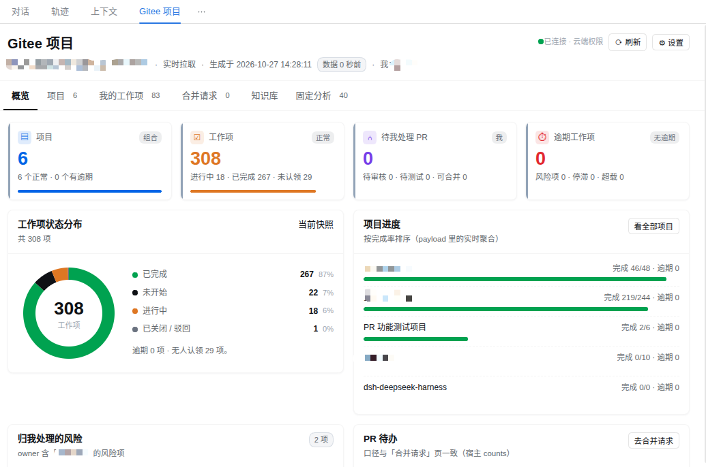

# dsh-gitee-chat

[](https://www.npmjs.com/package/dsh-gitee-chat)
[](https://github.com/huayuguo/dsh-gitee-chat/actions/workflows/check.yml)
[](https://www.npmjs.com/package/@deepseek-ai/dsh)
[](./LICENSE)

Gitee Enterprise project management inside a [DSH](https://github.com/deepseek-ai/deepseek-harness)
conversation: a full-page project workbench, a small set of write tools, and 55 bundled Gitee Enterprise
MCP tools.

- **The panel never eats context** — work items, merge requests and docs are fetched by the panel
  straight from the host, so data volume is irrelevant to the model.
- **Tools return summaries only** — `gitee_board` hands the model a few hundred tokens of summary
  while the card asks the host routes for the full payload.
- **Writing is bounded on purpose** — the UI exposes only the smallest write set (state / assignee /
  comment / create work item / PR actions); everything else goes through MCP.



## What you get

The **Gitee Project** entry in the session header is a **full-page workbench** (it renders in the
conversation body and does not take over or push out the right sidebar). Calling `gitee_board` also pins
a **board card** into the conversation; the workbench is where you drill down.

**There is no "Gitee mode" gate since 0.5.4**: the panel and the write routes work in any session. What
you see and change is decided by **your token's role in Gitee Cloud** plus `allowWrites`, never by the
session you happen to be in.

| Tab | Contents |
|---|---|
| Overview | Enterprise KPIs, risk reminders, recent activity |
| Projects | Project list + repo cards + work-item table (open / done / overdue / all); a row opens details, a repo card drills into three columns |
| My Work Items | Items where you are assignee **or** collaborator, with open / done / overdue filters |
| Merge Requests | Awaiting my review / awaiting my test / opened by me / all, times four states; a row opens the drawer |
| Knowledge Base | Project list + node tree with a draggable split; nodes and attachments load on demand, previews go to the sidebar |
| Fixed Analysis | Nine cards: project health / member load / overdue / stalled / conventions / schedule variance / capacity / milestones / delivery trend |

**Repo card drilldown**: three columns (project list | repo list | repo resources), column widths
draggable and remembered; scope defaults to "this project" and can switch to internal open-source,
kept across projects; the repo page has three tabs (work items / merge requests / WIKI) in warm tints.

**Merge request flow** (all inside the drawer): overview · changed files · comments · AI review →
approve / reject → tests pass → merge. **New PR** opens a panel dialog (repo / branches / title /
description / reviewer / tester count / draft / template) and posts to the host route `POST /pr/create`,
equivalent to the MCP tool `create_enterprise_repo_pull`.

**AI draft and review**: draft and review both run as a **subagent under the session you pick** (no user
message is injected into the main conversation); the panel polls the result and fills the form back in,
or offers one-click "comment + reject" / "comment only". Untick "subagent" to also deliver the result
into the selected main session. Review and test templates are bound separately and editable in the
panel; the PR description template is applied when creating a PR.

**Work items**: create (title / assignee / priority / schedule required), change state, reassign,
comment; four-color state pills; writes update in place instead of reloading the page. Details show the
description, prerequisites (Gitee IDs and WBS codes) and the comment thread.

**Capability tiers**: one agent preset, "Gitee 项目管理". The tier is not selected — it is derived on
every fetch from **the token's role and project relationships in Gitee Cloud**: enterprise owner /
super-admin / admin = manager (55 MCP tools); project assignee = project tier (48); everyone else = exec
tier (40, own work items only). Switching enterprise or token changes the tier immediately.

## Install

Requires DSH `^0.2.0-rc.2` and Node `^22.19 || >=24`.

```sh
# recommended: npm
dsh plugin --profile desktop add dsh-gitee-chat
```

| Source | Command | When |
|---|---|---|
| **npm** | `dsh plugin --profile desktop add dsh-gitee-chat` | default |
| GitHub Release asset | `dsh plugin --profile desktop add "https://github.com/huayuguo/dsh-gitee-chat/releases/download/v0.5.4/dsh-gitee-chat-0.5.4.tgz"` | npm is slow/unreachable |
| git tag | `dsh plugin --profile desktop add "git+https://github.com/huayuguo/dsh-gitee-chat.git#v0.5.4"` | pin a tag |
| local source | `npm install --legacy-peer-deps && npm run build`, then `add "file:$(pwd)"` | development |

- **Pick the right profile**: `desktop` for the desktop app, `web` for `dsh web`. A wrong profile fails
  **silently** — the UI simply shows nothing.
- On Windows use the app's own `dsh` (`<app>\resources\runtime\cli\bin\dsh.cmd`) or
  Settings → Plugins → Add plugin.
- **Upgrading means `remove` then `add`** — installs are copies. Coming from 0.5.3, your profile may still
  contain the old preset rows (`preset-gitee-exec` / `preset-gitee-manager`); remove them so you don't end
  up with two Gitee entries.
- npm publishes to the official registry only; mirrors sync automatically.
- After installing, open **Settings → Gitee Enterprise** and paste an enterprise access token.

To let an agent do it, the bundle ships `skills/dsh-gitee-chat/SKILL.md`; just ask it to install the
Gitee plugin and answer its questions.

## Configuration

Everything lives in **Settings → Gitee Enterprise** and applies on save (no restart). You need a
**Gitee Enterprise access token** — a personal-plan token cannot reach the enterprise endpoints, and
what that token may change is decided by its role in Gitee Cloud (otherwise you get 403/404).

| Option | Meaning |
|---|---|
| Enterprise token | Stored in `$DSH_HOME/.gitee-chat/token`; the fetch script and the MCP subprocess read the same file |
| Current enterprise | Pick one when the token can see several, so you never report another company's data |
| Sessions may read board snapshots | On by default: `gitee_board_snapshot` returns a cached snapshot with freshness instead of paging the API |
| Persist snapshots | On by default: cache goes to `$DSH_HOME/.gitee-chat/cache/board/` and survives restarts |
| Freshness (seconds) | Default 60, minimum 10, `0` disables the cache |
| Background refresh | Off by default; when on, the board is pre-fetched on the interval below |
| Refresh interval (seconds) | Default 60, minimum 10 |
| Idle pause (minutes) | Default 30 — stop refreshing while nobody is looking, to avoid spinning and rate limits |

The local cache override lives in `$DSH_HOME/.gitee-chat/config.json` and wins over the static values
in the plugin patch.

Token resolution order: `GITEE_ENT_MCP_ACCESS_TOKEN` / `GITEE_ACCESS_TOKEN` / `GITEE_TOKEN` →
`$DSH_HOME/.gitee-chat/token` → `$DSH_HOME/gitee-chat-token` → `~/.gitee-token`.
The desktop app launched from the menu does **not** inherit exported shell variables, so prefer the
settings page.

## Tools

| Tool | Purpose |
|---|---|
| `gitee_board` | Board summary (the model reads the summary, the panel reads the payload) |
| `gitee_board_snapshot` | Read the cached snapshot, returns `fetchedAt / ageSeconds / stale / ttlSeconds` |
| `gitee_role` | Identity, persona and capability tier of the current token |
| `gitee_enterprises` | List or switch the current enterprise |
| `gitee_chat_health` | Environment self-check (token / enterprise / connectivity) |
| `gitee_ent` | Public gateway: `op:"list"` → `op:"schema"` → `op:"call"`; outside the Gitee preset it reaches all 55 MCP tools |

Inside a Gitee preset session `gitee_ent` is deliberately hidden (so nobody bypasses the tier gate);
use the native `mcp__gitee_ent__*` tools, which are trimmed to the tier. Write tools are hard-blocked
in read-only deployments (`allowWrites: false`). The real permission boundary is always the Gitee token
role in the cloud.

## Bundled MCP

`vendor/mcp-gitee-ent/` ships the `mcp-gitee-ent` binaries (Linux / Windows amd64, upstream baseline
**v0.2.5**, 55 tools). On install they are copied to the user-level bin directory (`~/.local/bin` on
Linux/macOS, `%USERPROFILE%\.local\bin` on Windows), so no `go install` is needed; for other platforms
point `MCP_GITEE_ENT_BIN` at your own build. The MCP connection is process-level, with **no session-mode
gate**: any session can fetch, and writing is still decided by the cloud token. PR sub-resource
parameters are uniformly `pull_request_iid` (it was `pull_request_id` up to 0.5.3); the four
fork-owned PR tools (accept / reject / reset / test) were renamed in sync, and attachment downloads fall
back automatically on 404.

## Fetching and caching

- One fetch = spawn a Node script → HTTPS call to the Gitee Enterprise API, ~0.4s per round trip.
- Read routes carry a **30s TTL cache** and the executor memoizes results for another 60s, with
  single-flight (one in-flight request per key); both layers are cleared on writes, so repeat clicks
  are <10ms.
- Hovering a work item prefetches its detail, so opening it hits the cache.
- Paging is probed concurrently: 307 work items went from 2.6s to 1.6s; work-item detail from 1.8s to
  0.5s (detail and comments in parallel, index skipped when there are no prerequisites).
- The panel renders the previous snapshot first and refreshes behind it (fresh within 60s by
  default); sessions can read the same snapshot through `gitee_board_snapshot`, which returns
  `fetchedAt / ageSeconds / stale / ttlSeconds` so the model never presents stale numbers as live.
- Background refresh is optional and only runs while someone is actually looking at the panel.
- Slow requests log a `[gitee-chat][slow]` line; `GITEE_CHAT_TRACE=1` logs everything.

## Compatibility

DSH `^0.2.0-rc.2`, Node `^22.19 || >=24`, Linux / macOS / Windows. The repository's `check.yml` runs the
same self-check on every push, and `release.yml` publishes on `v*` tags.

## Development

```sh
npm install --legacy-peer-deps
npm run build        # lib/*.js + lib/types/ (host / agent / panel)
npm run check        # types + smoke + render assertions + capabilities + presets + MCP binary
npm run doctor       # portability check (presets / plugin row / artifacts / token / enterprise)
npm pack             # produce an installable tgz (only files listed in package.json `files`)
```

`src/index.ts` is the host half (routes, cache, write channel, settings), `src/agent.ts` is the agent
half (tools and persona), `src/client/` holds the panel components (`GiteeProjectView.tsx` is the
full-page entry) and `scripts/gitee/gq.mjs` is the fetch script.

## Docs

| Doc | Audience |
|---|---|
| [`USAGE.md`](./USAGE.md) | Users: how to use the UI and troubleshoot |
| [`skills/dsh-gitee-chat/SKILL.md`](./skills/dsh-gitee-chat/SKILL.md) | Agents: install / configure / diagnose / MCP usage (index layer, details in `references/{mcp,panel,recipes,install}.md`) |
| [`CONTRIBUTING.md`](./CONTRIBUTING.md) | Developers: build, self-check, code layout, commit conventions |
| [`CHANGELOG.md`](./CHANGELOG.md) | What changed in each release |
| [`SECURITY.md`](./SECURITY.md) | How to report a security issue (no public issue, please) |

Design notes, decision records, feature lists and the capability matrix are **internal material and
never shipped**; the published package only carries the external docs listed above.

中文: [README.md](./README.md)

## License

[MIT](./LICENSE) © 2026 Baoding Duopukang Intelligent Technology Co., Ltd. · jackxiao (xd20260413@outlook.com)
